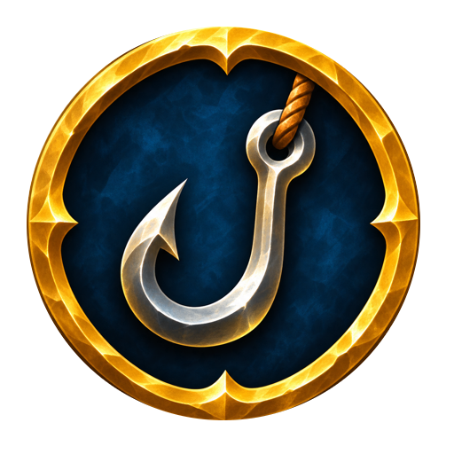

<p align="center"></p>

<h1 align="center">Cozy Fishing</h1>

<p align="center">
  A fishing hook on the screen while a fishing pole is in hand, for <b>World of Warcraft: Forever</b><br>
  left-click casts · right-click hooks · the catch of the session
</p>

<p align="center">
  <b>English</b> · <a href="README_UA.md">Українська</a>
</p>

> **Beta.** Built and checked outside the game; being tested in the game now.

## Installation

Copy or symlink the `CozyFishing` folder into `Interface/AddOns/` of the Forever client:

```sh
ln -s "$PWD/CozyFishing" "/Applications/World of Warcraft/_forever_/Interface/AddOns/CozyFishing"
```

## Features

| | |
|---|---|
| **Hook icon** | Shows when a fishing pole is in hand, hides when it comes off (also on a weapon swap in combat). The same hook as the cursor over a bobber, on a clear background. Pulses gold while the line is out |
| **Left-click** | Casts Fishing (optionally clearing the target first) |
| **Right-click** | While the line is out: hooks the fish |
| **Catch grid** | The total caught, then one cell per kind of fish or item with how many, in the order first caught. Clear background; hover a cell for the item's tooltip |
| **Session** | From putting a fishing pole on to taking it off or changing it for a weapon. Survives a `/reload` or a relog within 30 minutes. A summary goes to chat at the end (optional) |
| **Moving** | Alt + left-drag by default; Ctrl, Shift or Cmd (Mac) in the settings. Both frames move the same way |
| **Resizing** | Hover an unlocked frame and drag the grip in its bottom right corner, or use the sliders |
| **Locking** | The icon and the grid lock separately; a locked frame can't be moved or resized |
| **Minimap button** | Left-click opens the settings, right-click shows the frames for placing; drag it around the minimap. Can be hidden |

The grid can be turned off, and has a scale, a column count and a background opacity.

### How the hook works

An addon can't click the bobber itself. For the session Cozy Fishing turns on the game's soft targeting
of objects (`SoftTargetInteract 3`, with a wide arc and 30 yards), which makes your bobber the interact target.
While the line is out the icon stops taking the mouse, so a click on it lands in the game world, and while the
cursor is over it the right mouse button is bound to the game's **Interact with Target** (and the left one to
casting again). When the pole comes off, the settings go back to what they were (a value you changed yourself
meanwhile is left alone).

Addons that keep `SoftTargetInteract` in their own profile (Plater does) put their value back after loading;
Cozy Fishing sets it again before every cast while the session lasts.

The game doesn't tell addons when a fish bites (only the bobber and the splash sound show it), so the icon
can't react to the bite itself.

## Commands

| | |
|---|---|
| `/cf` | Settings |
| `/cf lock`, `/cf unlock` | Lock or unlock both frames |
| `/cf place` | Show the frames without a fishing pole, to place them |
| `/cf stats` | Print the catch of this session |
| `/cf clear` | Start the catch of this session over |
| `/cf reset` | Put the frames back in their default places |
| `/cf minimap` | Show or hide the minimap button |
| `/cf debug`, `/cf debug off` | Trace the hook in chat (and in the saved variables), for bug reports |

## Languages

English and Ukrainian, chosen in the settings.

## License

[MIT](LICENSE)
