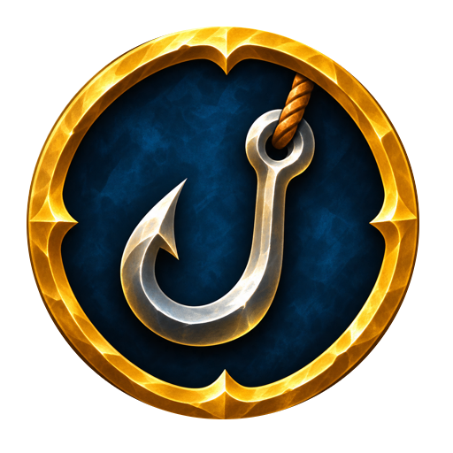

<p align="center"></p>

<h1 align="center">Cozy Fishing</h1>

<p align="center">
  Гачок на екрані, поки вудка в руках, для <b>World of Warcraft: Forever</b><br>
  лівий клік закидає · правий клік підсікає · улов за сесію
</p>

<p align="center">
  <a href="README.md">English</a> · <b>Українська</b>
</p>

> **Бета.** Зібрано й перевірено поза грою; зараз перевіряється в грі.

## Встановлення

Скопіюйте папку `CozyFishing` або зробіть на неї символьне посилання в `Interface/AddOns/` клієнта Forever:

```sh
ln -s "$PWD/CozyFishing" "/Applications/World of Warcraft/_forever_/Interface/AddOns/CozyFishing"
```

## Можливості

| | |
|---|---|
| **Іконка гачка** | З'являється, коли вудка в руках, і зникає, коли її знято (також коли міняєте на зброю в бою). Такий самий гачок, як курсор над поплавком, на прозорому фоні. Поки поплавок на воді, пульсує золотим. Якщо призначено клавіші закинути й підсікти, її можна сховати разом зі смужкою часу (кнопка приманки лишається) |
| **Лівий клік** | Закидає вудку (за бажанням спершу знімає ціль) |
| **Правий клік** | Поки поплавок на воді: підсікає рибу |
| **Клавіші** | Закинути, підсікти й поміняти вудку: на кожну дію своя клавіша чи комбінація, прямо в налаштуваннях аддона (клік, потім натиснути клавішу) або в призначенні клавіш гри (AddOns > Cozy Fishing). Закидання й підсічка окремо, тож невдалий закид мимо косяка можна одразу повторити. Підходять кнопки миші й геймпада, якщо геймпад увімкнено в налаштуваннях гри |
| **Кнопка заміни** | Клік бере вудку із сумки, наступний повертає зброю, яка була в руках, разом із лівою рукою (запам'ятовується щоразу, коли вудка опиняється в руках, кнопкою чи вручну). Працює в бою. Можна пересувати, змінювати розмір і ховати, зокрема лише поки для заміни призначено клавішу |
| **Час закиду** | Смужка над гачком показує, скільки ще поплавок на воді |
| **Нагадування про приманку** | Поки на вудці немає приманки, а в сумці вона є, біля гачка з'являється кнопка, яка ставить на вудку найкращу приманку, яку дозволяє навичка |
| **Сітка улову** | Загальний улов, навичка рибальства (з бонусом вудки й приманки та очками, здобутими за сесію), а під ними клітинка на кожен вид риби чи предмета з кількістю, у порядку, в якому їх уперше виловлено. Прозорий фон; наведіть на клітинку, щоб побачити підказку предмета, правий клік приглушує цей предмет і переносить у кінець (непотріб); усе виловлене показується завжди |
| **Історія** | `/cf history` або Shift + клік по кнопці біля мінімапи: що виловлено в кожній зоні за всі сесії (частка кожного предмета, скільки закидів щось принесли, улов за годину) і минулі сесії |
| **Рибальський похід** | Кнопка «старт» (▶) біля гачка починає похід і стає кнопкою «стоп» (■) з часом походу під нею. Усі сесії між ними складаються разом, а «стоп» показує звіт: підсумок (час, улов, закидання, улов за годину, здобута навичка, зони), усе виловлене й кожна сесія окремо. Переживає `/reload` і вихід із гри, доки похід не зупинено; минулі походи є в історії |
| **Сесія** | Від того, як ви берете вудку, до того, як знімаєте її чи міняєте на зброю. Переживає `/reload` або перезахід протягом 30 хвилин. Наприкінці підсумок пишеться в чат (за бажанням) |
| **Переміщення** | Типово Alt + перетягування лівою; у налаштуваннях можна вибрати Ctrl, Shift або Cmd (Mac). Обидві рамки рухаються однаково |
| **Розмір** | Наведіть на незакріплену рамку й тягніть за кут унизу праворуч, або скористайтеся повзунками |
| **Закріплення** | Іконка й сітка закріплюються окремо; закріплену рамку не можна пересунути чи змінити її розмір |
| **Кнопка біля мінімапи** | Лівий клік відкриває налаштування, Shift + клік історію, правий показує рамки, щоб їх розставити; перетягується по краю мінімапи. Можна сховати |

Сітку можна вимкнути; у неї є масштаб, кількість стовпців і непрозорість фону.

### Як працює підсічка

Аддон не може сам клікнути на поплавок. На час сесії Cozy Fishing вмикає м'яке наведення гри на об'єкти
(`SoftTargetInteract 3`, із широкою дугою та 30 ярдами), і ваш поплавок стає ціллю для взаємодії. Поки поплавок
на воді, іконка не перехоплює мишу, тож клік по ній потрапляє у світ гри, а поки курсор над іконкою, правий клік
прив'язано до ігрової дії **Взаємодія з ціллю** (а лівий до нового закидання). **Клавіша підсічки** працює так само:
поки вудка в руках, її клавіші тимчасово стають **Взаємодією з ціллю**, а коли вудку знято, повертаються. Коли
вудку знято, налаштування повертаються як були (якщо ви за цей час самі змінили значення, його не чіпає).

Аддони, що зберігають `SoftTargetInteract` у своєму профілі (так робить Plater), після завантаження повертають
своє значення; Cozy Fishing ставить його знову перед кожним закиданням, поки триває сесія.

Гра не повідомляє аддонам, коли клює риба (це видно лише по поплавку й чути по сплеску), тож іконка не може
реагувати саме на клювання.

## Команди

| | |
|---|---|
| `/cf` | Налаштування |
| `/cf lock`, `/cf unlock` | Закріпити чи відкріпити всі рамки |
| `/cf place` | Показати рамки без вудки, щоб їх розставити |
| `/cf stats` | Вивести улов цієї сесії |
| `/cf history` | Історія рибальства та улов за зонами |
| `/cf swap` | Поміняти зброю й вудку |
| `/cf trip` | Почати рибальський похід або зупинити його й подивитися звіт |
| `/cf clear` | Почати улов цієї сесії з нуля |
| `/cf reset` | Повернути рамки на початкові місця |
| `/cf minimap` | Показати чи сховати кнопку біля мінімапи |
| `/cf debug`, `/cf debug off` | Журнал підсічки в чаті (і в збережених змінних), для звітів про помилки |

## Розробка

`luacheck .` і `lua tests/run.lua` з кореня репозиторію: тести завантажують увесь аддон у несправжньому API гри
й відіграють сесії рибальства. І те, й інше запускається на кожен push і перед кожним релізом.

## Мови

Англійська й українська, вибираються в налаштуваннях.

## Ліцензія

[MIT](LICENSE)
