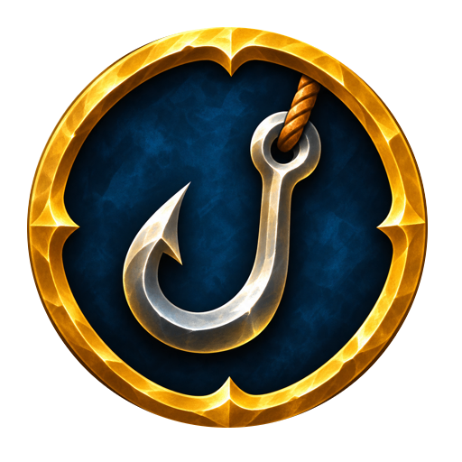

**A fishing hook on your screen (or your own keys): cast, hook the fish, swap the pole. The catch of the session, fishing trips, history.**

> **Early development.** Cozy Fishing is young. If something looks wrong or you miss a feature, please tell me
> in the comments or on [GitHub](https://github.com/v-gachkovsky/cozy-fishing/issues): no report is too small.

No more hunting for the bobber with the mouse. Take a fishing pole in hand and a hook appears on the screen.
Click it to cast; when the fish bites, right-click it to reel in. Or put casting and hooking on keys of your own,
a gamepad's buttons too. Next to it, a see-through grid counts what you've caught.

## New in 0.2.0

Keys of your own for cast, hook and swap; a button that swaps your weapon for the fishing pole and back; fishing
trips with a report at the end; a history of every zone and session; a cast timer; a lure reminder; your Fishing
skill in the catch.

**For WoW Forever.**

---

## How it works

- **The hook shows up with the pole.** Put a fishing pole on and the hook appears: the same hook as the cursor
  over a bobber, on a clear background. Take the pole off or change it for a weapon (even in combat) and it's gone.
- **Left-click** casts Fishing. It can clear your target first, so the hook goes to the bobber.
- **Right-click** while the line is out hooks the fish, wherever the bobber landed. The hook pulses gold while
  the line is out, so you know a right click now reels in.
- **Keys**: one key to cast, another to hook, a third to swap the pole. Set each right in the addon's settings:
  click, then press a key or a combination (a mouse button or a gamepad button work too). A key that already
  does something asks first, and gets its old action back when you change it later. They're also in Key
  Bindings > AddOns > Cozy Fishing. Cast and hook are separate, so a cast that missed the school can be cast
  again at once. With both keys set, the hook icon can be hidden if you like.
- **Swap button**: one click takes the fishing pole from the bags, the next puts back the weapon you had (and
  the off hand). The weapons are remembered whenever the pole goes on, by the button or by hand. Works in
  combat too, for when a mob shows up mid-cast. Can hide while there's a key for it.
- **Cast timer**: a bar over the hook shows how long the line stays out.
- **Lure reminder**: no lure on the pole and one in the bags? A small button by the hook puts the best one
  your skill allows on.
- **The catch of the session**: the total on top, your Fishing skill under it (with the pole and lure bonus, and
  the points gained this session), then one cell per kind of fish or item with how many, in the order you
  caught them. Hover a cell for the item's tooltip; right-click it to dim junk and move it to the end (it's
  never hidden away). No frame and no background, unless you want one.
- **History**: what you caught in each zone over all sessions (each item's share, how many casts caught
  something, catches an hour), and your past sessions. `/cf history`, or Shift-click the minimap button.
- **Fishing trip**: a start button begins a trip and turns into stop, with the trip's time under it. Every
  session in between adds up, and the stop shows a report: time, catch, casts, catches an hour, skill gained,
  zones, everything caught, and each session. A trip lasts over reloads and logouts until you stop it; past
  trips stay in the history.
- **A session** lasts from putting the pole on to taking it off. It survives a `/reload` or a quick relog, and
  a summary goes to chat at the end if you like.
- **Move** the hook, the grid and the swap and trip buttons with **Alt + left-drag** (or Ctrl, Shift, Cmd on a
  Mac), **resize** them by the corner, and **lock** each one separately.
- **Minimap button**: click for the settings, Shift-click for the history, right-click to show the frames
  without a pole, to place them.

## How the hook works

An addon can't click the bobber itself, so Cozy Fishing uses the game's own **soft targeting**: for the session
it lets the game target objects, which makes your bobber the interact target, and the right click on the hook
becomes the game's **Interact with Target**. When the pole comes off, those game settings go back to what they
were. Addons that keep the setting in their own profile (Plater does) are handled: it's set again before every
cast.

The game doesn't tell addons when a fish bites; watch the bobber or listen for the splash, then right-click.

## Settings (`/cf`)

Showing and locking the hook, the grid, the swap and trip buttons; the hook's size; hiding the hook (or the
swap button) when there are keys for it; clearing the target when casting; the cast timer; the lure reminder;
your own keys for cast, hook and swap; the grid's scale, columns, background and skill line; the chat summary;
bringing back dimmed items; the minimap button; the key that moves the frames; the language (English or
Ukrainian).

## Commands

- `/cf`: settings
- `/cf lock`, `/cf unlock`: lock or unlock all the frames
- `/cf place`: show the frames without a fishing pole, to place them
- `/cf stats`: print the catch of this session
- `/cf history`: fishing history and the catch by zone
- `/cf swap`: swap the weapon and the fishing pole
- `/cf trip`: start a fishing trip, or stop it and see its report
- `/cf clear`: start the catch of this session over
- `/cf reset`: put the frames back in their default places
- `/cf minimap`: show or hide the minimap button
